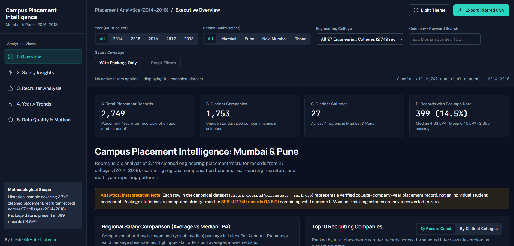

# Campus Placement Intelligence — Mumbai & Pune

End-to-end data analytics portfolio project: multi-file raw placement data audit and reconciliation → reproducible Python cleaning pipeline → interactive multi-section analytics dashboard.

Built with **Python 3** for data cleaning, algorithmic/rule-based entity resolution, and statistical aggregation, and **HTML5, CSS3, JavaScript, and Chart.js** for the interactive analytics interface.

**Live demo:** [https://college-placement-dashboard.vercel.app/](https://college-placement-dashboard.vercel.app/)



---

## 1. Project Objective & Analytical Questions

Campus placement datasets typically arrive as overlapping, inconsistently formatted spreadsheets with leaked headers, duplicate entries, mixed salary units (`/yr`, `/mo`, `/hr`), and hundreds of company spelling variations.

This project reconciles **7 raw CSV files** into a single authoritative dataset (`data/processed/placements_final.csv`) covering **2,749 placement/recruiter records** across **27 engineering colleges** in **Mumbai, Pune, Navi Mumbai, and Thane (2014–2018)**, and provides an interactive 5-section analytics application answering:

1. **Overview & Regional Benchmarks:** What do typical (median) vs average (mean) compensation packages look like across Mumbai, Pune, Navi Mumbai, and Thane?
2. **Salary Insights & Distribution:** How are reported packages distributed across LPA brackets, and how strongly do upper-tail outliers skew regional averages?
3. **Recruiter Footprint Analysis:** Which companies recruit most consistently across distinct colleges and years, and where do specific recruiters appear?
4. **Historical Reporting Trends (2014–2018):** How do annual record counts compare against the number of reporting colleges per year?
5. **Data Quality & Lineage:** How many records were removed at each cleaning stage, how do observed counts compare against expected validation targets, and why were specific raw files excluded?

---

## 2. Dataset Scope & Validated Baseline Metrics

All audit metrics below are computed directly from the source files by `scripts/04_export_dashboard_data.py` and verified against expected baseline targets:

| Metric | Expected Baseline | Observed Computed Value | Notes |
|---|---:|---:|---|
| **Raw master records** | `3,098` | `3,098` | From `data/raw/placement_companies.csv` |
| **Leaked header rows removed** | — | `6` | Rows where company name equaled `"NAME OF COMPANY"` |
| **Exact duplicate rows removed** | — | `325` | Initial deduplication on `(company, college, region, year)` |
| **Records after Stage 1 cleaning** | `2,767` | `2,767` | Saved to `data/processed/placements_clean.csv` |
| **Unique companies before name merge** | `1,986` | `1,986` | Upper-cased, whitespace-normalized company strings |
| **Candidate merge proposals generated** | — | `240` | `181` Tier-1 formatting + `59` Tier-2 fuzzy pairs (`ratio ≥ 0.92`) |
| **Proposals excluded by `RISKY` set** | — | `7` | Filtered using the `12`-term `RISKY` exclusion set in `03_merge_company_names.py` |
| **Variant mappings applied** | — | `232` | Union-find canonical consolidation + `10` `FIX` dictionary rules |
| **Unique companies after canonical merge** | `1,753` | `1,753` | Final canonical company count |
| **Post-merge duplicates removed** | — | `18` | Deduplicated after company name standardization |
| **Final canonical records** | `2,749` | `2,749` | Authoritative dataset in `data/processed/placements_final.csv` |
| **Distinct engineering colleges** | `27` | `27` | Across Mumbai, Pune, Navi Mumbai, and Thane |
| **Records with valid package (LPA)** | `399` | `399` (`14.51%`) | Sourced from explicit-unit salaries in `data/raw/variation_3.csv` |
| **Historical period** | `2014–2018` | `2014–2018` | 2014: `21` · 2015: `206` · 2016: `265` · 2017: `299` · 2018: `1,958` |

### Regional Compensation Summary (on 399 valid package records)

| Region | Total Records | Package Records (`n`) | Coverage % | Median (Typical) | Average (Mean) | IQR (Q1–Q3) | Min – Max |
|---|---:|---:|---:|---:|---:|---:|---:|
| **Mumbai** | 752 | 138 | 18.4% | **6.42 LPA** | 7.16 LPA | 4.67 – 7.92 LPA | 1.10 – 17.65 LPA |
| **Pune** | 1,429 | 156 | 10.9% | **4.83 LPA** | 6.67 LPA | 3.75 – 7.68 LPA | 0.96 – 29.95 LPA |
| **Navi Mumbai** | 423 | 83 | 19.6% | **4.43 LPA** | 5.30 LPA | 3.58 – 6.48 LPA | 1.56 – 17.65 LPA |
| **Thane** | 145 | 22 | 15.2% | **3.93 LPA** | 4.81 LPA | 3.43 – 5.22 LPA | 2.13 – 11.76 LPA |

---

## 3. Data-Cleaning Pipeline & Reproducibility

```
data/raw/ (7 CSVs)
   → scripts/01_clean_data.py              Drop leaked headers, normalize text, deduplicate, convert ₹/yr & ₹/mo to LPA
   → scripts/02_propose_company_mapping.py Generate Tier-1 formatting & Tier-2 fuzzy company merge proposals (ratio ≥ 0.92)
   → scripts/03_merge_company_names.py     Apply proposals with explicit RISKY exclusion rules & FIX dictionary, re-deduplicate
   → scripts/04_export_dashboard_data.py   Compute audit metrics & export canonical dataset to assets/data.js
   → scripts/05_build_preview.py           Generate static PNG overview chart for documentation (optional)
```

### Multi-File Source Audit (`data/raw/`)
- [`data/raw/placement_companies.csv`](data/raw/placement_companies.csv) (`3,098` rows): Primary master list of `(name of company, college name, region, year)`.
- [`data/raw/variation_3.csv`](data/raw/variation_3.csv) (`463` rows): Selected as the primary salary source because each entry includes explicit currency and time units (`₹/yr` or `₹/mo`).
- [`data/raw/detailed_data.csv`](data/raw/detailed_data.csv) (`462` rows): Audited and **excluded** because its unitless numeric `Salary` column disagrees with `variation_3.csv` on `106` deduplicated keys (`122` raw rows) due to row-shift alignment errors.
- [`data/raw/variation_2.csv`](data/raw/variation_2.csv) (`1,002` rows): Audited and **excluded** because it lacks college and year keys and contains `2` non-INR/hourly entries (`EBAY £37/hr`, `EXCEL ENGINEERING SERVICES ₹1,070/hr`).
- [`data/raw/variation_1.csv`](data/raw/variation_1.csv), [`data/raw/region_mumbai.csv`](data/raw/region_mumbai.csv), [`data/raw/region_pune.csv`](data/raw/region_pune.csv): Verified as subsets/duplicates of the master file.

---

## 4. Architecture & Features

The application uses a **single-source-of-truth static web architecture**:
- **Single Canonical Frontend:** `index.html` + `assets/app.js` + `assets/data.js` + `assets/config.js` + local vendored `assets/chart.umd.min.js`.
- **Resilient Chart Rendering:** Chart.js 4.4.1 is bundled locally in `assets/chart.umd.min.js` (eliminating external CDN failure risk), and `assets/app.js` includes explicit container fallback guards so all KPIs, tables, filters, and CSV exports continue working even if chart rendering is unavailable.
- **5 Interactive Analytical Views:**
  1. **Overview:** Executive KPI cards, regional mean vs median comparison, top 10 recruiters (toggleable by record count vs distinct colleges), dual-axis historical reporting trend, regional package coverage breakdown, and live calculated descriptive observations.
  2. **Salary Insights:** Median, mean, range, and IQR cards, 6-bracket LPA distribution histogram, regional quartile comparison chart, regional summary table, and sortable college-level benchmark table.
  3. **Recruiter Analysis:** Top 10 grouped comparison chart + searchable, sortable, paginated directory of all **1,753 canonical companies** with **expandable company rows** showing exact college, region, year, and package records.
  4. **Yearly Trends (2014–2018):** Annual placement record counts juxtaposed against participating college counts and regional coverage, with methodological guidance on sample composition.
  5. **Data Quality & Methodology:** Automated Baseline Target vs Observed Value validation table, 3-stage cleaning funnel, field-level completeness audit, 7-file raw source inventory with observed column schemas, and rule-based company standardization examples.
- **Global Multi-Dimensional Filtering & CSV Exports:** Filter simultaneously by **Year**, **Region**, **College**, **Company/Keyword Search**, and **With Package Only**, and export either filtered records (`Export Filtered CSV`) or aggregated company statistics (`Export Recruiter Summary CSV`).

---

## 5. Known Limitations & Analytical Guardrails

1. **Placement Record ≠ Unique Student Placed:** One row represents a company recruiting at a specific college in a given year. Never interpret record counts as student headcount or placement percentage.
2. **Partial Package Coverage (14.51%):** Only 399 of 2,749 records contain salary data. Missing salaries remain `null` and are never zero-filled.
3. **Uneven Yearly Reporting Coverage:** 2018 accounts for 1,958 records (`71.2%`) because 24 colleges reported data in 2018 vs only 2 colleges in 2014. Rising record counts reflect broader reporting coverage rather than verified hiring growth.
4. **Rule-Based Company Standardization:** Company name standardization uses generated proposals (`02_propose_company_mapping.py`) filtered by an explicit `RISKY` exclusion set and `FIX` dictionary (`03_merge_company_names.py`). Conservative thresholds (`ratio ≥ 0.92`) leave some minor spelling variations unmerged to avoid false merges.
5. **No Branch / Department Column:** The source files do not include engineering branch (e.g., CSE, IT, ECE).
6. **Historical Demonstration Scope:** This is a historical demonstration dataset (`2014–2018`), not a live institutional placement feed.

---

## 6. Project Structure

- [`index.html`](index.html) — Main analytics dashboard application (HTML5 + CSS3)
- [`assets/app.js`](assets/app.js) — Authoritative filtering engine, statistical layer & UI controller
- [`assets/chart.umd.min.js`](assets/chart.umd.min.js) — Locally vendored Chart.js v4.4.1 bundle
- [`assets/config.js`](assets/config.js) — Author and repository link configuration
- [`assets/data.js`](assets/data.js) — Generated canonical dataset & computed data-quality audit
- [`data/raw/`](data/raw/) — 7 unmodified source CSVs + [`data/raw/README.md`](data/raw/README.md)
- [`data/processed/`](data/processed/) — Cleaned datasets ([`placements_clean.csv`](data/processed/placements_clean.csv), [`placements_final.csv`](data/processed/placements_final.csv)) and company mappings ([`company_mapping_proposed.csv`](data/processed/company_mapping_proposed.csv), [`company_mapping_applied.csv`](data/processed/company_mapping_applied.csv))
- [`scripts/01_clean_data.py`](scripts/01_clean_data.py) — Step 1: Data cleaning & LPA normalization
- [`scripts/02_propose_company_mapping.py`](scripts/02_propose_company_mapping.py) — Step 2: Candidate company-name merge generation
- [`scripts/03_merge_company_names.py`](scripts/03_merge_company_names.py) — Step 3: Rule-based merge application & deduplication
- [`scripts/04_export_dashboard_data.py`](scripts/04_export_dashboard_data.py) — Step 4: Reproducible audit & export to `assets/data.js`
- [`scripts/05_build_preview.py`](scripts/05_build_preview.py) — Step 5: Static PNG preview generator (optional, requires matplotlib)
- [`docs/dashboard-preview.png`](docs/dashboard-preview.png) — Static preview image for documentation
- [`requirements.txt`](requirements.txt) — Python dependencies
- [`vite.config.ts`](vite.config.ts) — Vite dev server & static bundle configuration
- [`vercel.json`](vercel.json) — Zero-build static deployment configuration for Vercel

---

## 7. Run Locally & Reproduce the Pipeline

### Run the Complete Python Pipeline (Steps 1–4)
All four core data-pipeline scripts (`01` through `04`) run with Python 3 standard library out of the box:

```bash
python3 scripts/01_clean_data.py
python3 scripts/02_propose_company_mapping.py
python3 scripts/03_merge_company_names.py
python3 scripts/04_export_dashboard_data.py
```

### Launch the Dashboard
- **Vite Development Server:** Run `npm run dev` (starts on `http://localhost:3000`).
- **Production Build:** Run `npm run build` (outputs static bundle to `dist/` with all `dist/assets/*` files copied).
- **Direct Static Server:** Run `python3 -m http.server 3000` from the repository root.

---

## 8. Deployment on Vercel

1. Push the repository to GitHub.
2. On [vercel.com](https://vercel.com), click **Add New → Project** and import the repository.
3. [`vercel.json`](vercel.json) configures zero-build static hosting from the repository root (`.`), serving [`index.html`](index.html) and [`assets/`](assets/) directly.

---

## Author

**Jitesh** · [GitHub](https://github.com/immortalityonpeak0987-coder/College_Placemet_Dashboard_Data_Analytics) · [LinkedIn](https://www.linkedin.com/in/jitesh-hati-096500443) (configured in [`assets/config.js`](assets/config.js))
