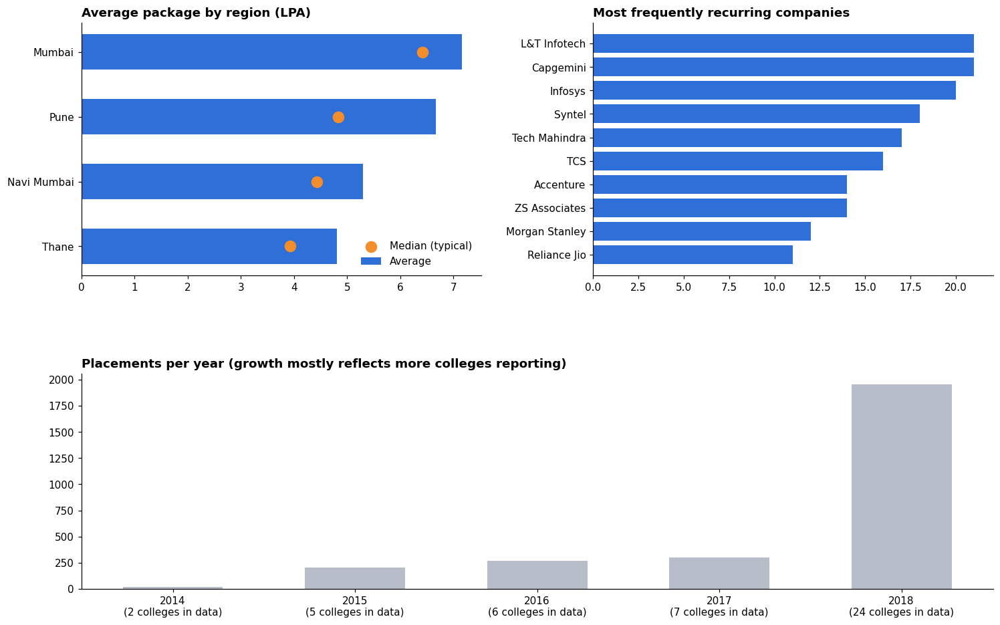

# Campus Placement Analysis: Mumbai & Pune Colleges

A data analysis project: clean a messy, multi-file placement dataset with **Python + pandas**, answer three practical questions, and present the results as an interactive dashboard website (Chart.js, hosted on Vercel).

**Live demo:** _add your Vercel URL here_



## Questions answered
1. **What does a typical package look like?** Average vs median package (LPA) by region.
2. **Which companies recruit most often?** Top 10 by number of placement records and number of colleges they appear at.
3. **How do placements change year over year?** Placements per year (2014 to 2018) alongside the number of colleges reporting data.

## Key findings
| Finding | Number |
|---|---|
| Records after cleaning | 2,749 (from 3,098 raw) |
| Distinct companies | 1,753 (from 1,986 before name merging) |
| Colleges | 27 |
| Records with a package | 399 |
| Highest average package | Mumbai, 7.16 LPA (median 6.42) |
| Pune | average 6.67 LPA, median 4.83 |
| Most frequent recruiters | L&T Infotech, Capgemini, Infosys, Syntel, Tech Mahindra |
| Placements per year | 2014: 21, 2015: 206, 2016: 265, 2017: 299, 2018: 1,958 |

The jump in 2018 mostly reflects more colleges appearing in the data (24 colleges in 2018 vs 2 in 2014), not necessarily real growth.

## Data cleaning steps
- Dropped header rows that leaked into the data and removed exact duplicate records.
- Normalised company, college and region text (trim, collapse whitespace, upper-case).
- Converted package strings to a single numeric **LPA** column (yearly values ÷ 100,000; monthly values × 12 first). Rows in other units are left empty.
- Standardised inconsistent company names: formatting-only variants merged automatically; typo-like pairs merged after manual review; pairs judged to be different companies or divisions were left unmerged (see `RISKY` in [`03_merge_company_names.py`](03_merge_company_names.py)).
- Removed duplicates created by the name merge.

## Limitations
- Package data exists for only 399 of 2,749 records, so package averages are less reliable.
- The dataset has **no branch column**, so results are by region and college.
- Package source is `variation_3.csv` (explicit units). `detailed_data.csv` disagrees with it on about 107 rows and was not used.
- Some company spelling variants are still unmerged (the fuzzy matching threshold was kept strict to avoid false merges).
- This is a sample/dummy dataset used for demonstration.

## Project structure
- [`index.html`](index.html): Dashboard page (open directly or deploy)
- [`assets/config.js`](assets/config.js): Author details & profile links
- [`assets/data.js`](assets/data.js): Generated by step 4; the numbers the page reads
- [`01_clean_data.py`](01_clean_data.py): Clean + package to LPA
- [`02_propose_company_mapping.py`](02_propose_company_mapping.py): Propose name merges for review
- [`03_merge_company_names.py`](03_merge_company_names.py): Apply reviewed merges
- [`04_export_dashboard_data.py`](04_export_dashboard_data.py): Write assets/data.js
- [`05_build_preview.py`](05_build_preview.py): Static PNG preview for this README

## Run the pipeline
```bash
pip install -r requirements-dev.txt
python3 01_clean_data.py
python3 02_propose_company_mapping.py
python3 03_merge_company_names.py
python3 04_export_dashboard_data.py
python3 05_build_preview.py   # optional
```
Then open [`index.html`](index.html) in a browser (it needs internet for Chart.js and Google Fonts).

## Deploy on Vercel
1. Push this folder to a GitHub repository.
2. On vercel.com choose **Add New → Project** and import the repository.
3. It is a static site, so no build command is needed. Deploy, then paste the URL into this README.

## Tech
Python, pandas, matplotlib (preview only), HTML/CSS/JavaScript, Chart.js 4.4.1 (via cdnjs).
